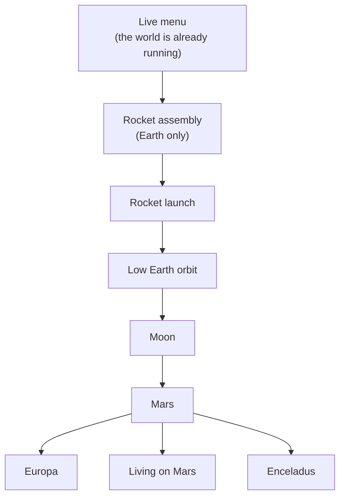

# Journey Map — NASA Explorer

The game is a sequence of journeys. Each journey introduces new movement, new facts, and new decisions, then branches after Mars.

## Stages

| # | Stage | New mechanic | Learning focus |
|---|---|---|---|
| 0a | Live menu | None — the menu shares the game world | Interface only; the world is already alive |
| 0b | Rocket assembly (Earth) | Part selection, mass / thrust / cost trade-offs | Spacecraft, instruments, launch vehicle, mass, budget |
| 1 | Rocket launch | Rotation, power/throttle, staging | TWR, gravity turn, staging, orbital insertion |
| 2 | Low Earth orbit | Orbital motion, EVA enter/exit | Orbits, free-fall, leaving the vehicle |
| 3 | Moon | Low-gravity surface traversal, landing | Gravity differences, powered descent, lunar exploration |
| 4 | Mars | Heavier-gravity surface traversal, rover | Interplanetary travel, surface conditions |
| 5a | Europa | Swimming | Subsurface oceans and icy moons |
| 5b | Living on Mars | Base interaction | Sustaining humans on another world |
| 5c | Enceladus | Jetpack flight | Icy plumes and outer-solar-system exploration |

> After Mars the player can branch to **Europa**, **Living on Mars**, or **Enceladus**. Stage order is content that can grow over time.

Travel is simulated with realistic durations (see [`flight_model.md`](flight_model.md)); the player can accelerate time at any point during cruise.

## Stage details

### 0a. Live menu

- **Narrative:** The world is already in motion behind the menu.
- **Gameplay:** Menu options sit on the left with no panel or backdrop; selecting **Start Game** retires the menu rather than loading a scene.
- **Mechanic:** The game world runs continuously; the menu is an overlay, not a separate screen.
- **Learning focus:** None — this is presentation and onboarding.
- **Stubs:** **Start Multiplayer** and **Login** show "coming soon".

### 0b. Rocket assembly (Earth only)

- **Narrative:** The mission begins on Earth, in the assembly/launch site.
- **Gameplay:** Choose a launch vehicle, stages, instruments, spacecraft, and surface equipment.
- **Mechanic:** Live mass, TWR, Δv, and cost readouts with warnings; the design locks at launch.
- **Learning focus:** How mass, thrust, propellant, and budget constrain a mission.
- **NASA facts:** _TODO — add assembly-fact(s) and link them in [`nasa_data_sources.md`](nasa_data_sources.md)._

### 1. Rocket launch

- **Narrative:** The mission lifts off from the Earth launch pad.
- **Gameplay:** Control rotation, power/throttle, and staging through the atmosphere.
- **Mechanic:** Force-based ascent with atmospheric drag and gravity; a good gravity turn saves propellant.
- **Learning focus:** Thrust-to-weight ratio, gravity turn, staging, and orbital insertion.
- **Failure:** A TWR below 1 or a failed insertion explains itself and lets the player retry assembly.
- **NASA facts:** _TODO — add the fact(s) surfaced here and link them in [`nasa_data_sources.md`](nasa_data_sources.md)._

### 2. Low Earth orbit

- **Narrative:** The astronaut reaches orbit and sees Earth from above.
- **Gameplay:** Adjust to microgravity movement; leave and re-enter the rocket.
- **Mechanic:** Orbital motion and momentum control; EVA in free-fall.
- **Learning focus:** Why orbiting is continuous free-fall, and how spacecraft stay in space.
- **NASA facts:** _TODO._

### 3. Moon

- **Narrative:** A first stop beyond Earth.
- **Gameplay:** Powered descent and careful landing; surface traversal with lower gravity.
- **Mechanic:** Landing within velocity/angle limits; jumping and landing tuned by lunar gravity.
- **Learning focus:** Gravity differences, descent burns, and how lunar exploration works.
- **Failure:** A hard landing destroys the vehicle and explains the safe thresholds.
- **NASA facts:** _TODO._

### 4. Mars

- **Narrative:** The long journey to the red planet.
- **Gameplay:** Surface traversal with heavier gravity; rover use; the hub for branching.
- **Mechanic:** Movement contrast with the Moon; landing with a thin atmosphere and real gravity.
- **Learning focus:** Interplanetary travel times, surface conditions, and rover mobility.
- **NASA facts:** _TODO._

### 5a. Europa

- **Narrative:** An icy moon with a hidden ocean.
- **Gameplay:** **Swimming** through a subsurface ocean.
- **Mechanic:** Fluid-based movement under the ice.
- **Learning focus:** Subsurface oceans, habitability, and the Europa Clipper mission.
- **NASA facts:** _TODO._

### 5b. Living on Mars

- **Narrative:** What it takes to live on another world.
- **Gameplay:** Colony/base interaction.
- **Mechanic:** _TODO — define the interaction model._
- **Learning focus:** Sustaining humans on another world.
- **NASA facts:** _TODO._

### 5c. Enceladus

- **Narrative:** Plumes and ice at the edge of the journey.
- **Gameplay:** **Jetpack flight** and traversal of an icy surface.
- **Mechanic:** Thrust-based movement in very low gravity.
- **Learning focus:** Icy plumes, ocean worlds, and outer-solar-system exploration.
- **NASA facts:** _TODO._

## Planet views

At every planet or moon the player can switch between:

- **Character-level view** — the astronaut or rover on the surface at human scale.
- **Whole-planet view** — the entire body, showing the landing site and **far-side discoveries** that humanity has already made.

Far-side discoveries give the player reasons to travel across the body by rocket or surface vehicle, and each is paired with a cited NASA fact.

## Quizzes

At every planet or moon an **optional quiz icon** appears. Quizzes never block progress; they reinforce what the player has just seen and explain the answer. See [`learning_design.md`](learning_design.md).

## Progression diagram notes

- The diagram mirrors the flow: live menu → Earth-only assembly → a linear ascent to Mars → three parallel destinations.
- Branch unlocks and the order in which they become available are tuned during implementation.
- Facts and quiz content for each stage are tracked in [`nasa_data_sources.md`](nasa_data_sources.md) and [`learning_design.md`](learning_design.md).
