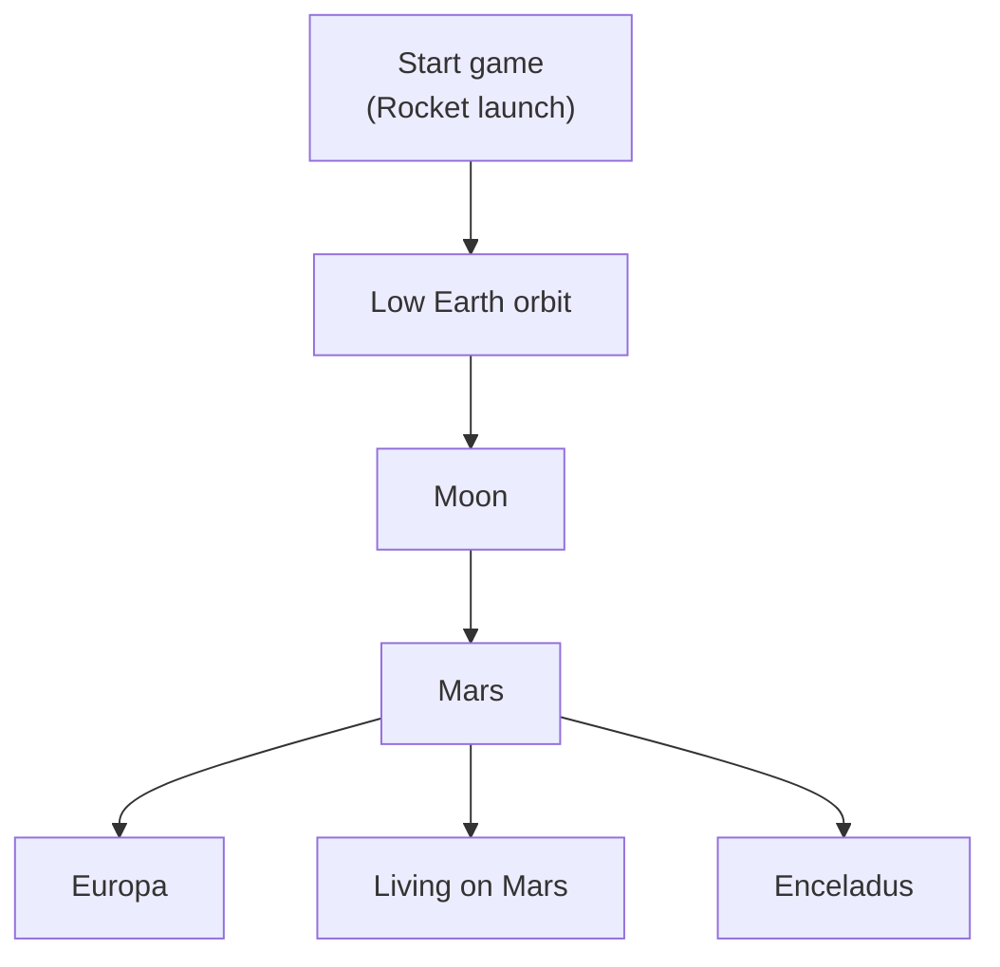

# Journey Map — NASA Explorer

The game is a sequence of journeys. Each journey introduces new movement, new facts, and new decisions, then branches after Mars.

## Stages

| # | Stage | New mechanic | Learning focus |
|---|---|---|---|
| 1 | Rocket launch | Launch power and direction | Spacecraft and launch vehicle decisions |
| 2 | Low Earth orbit | Microgravity movement | Orbits and how spacecraft stay in space |
| 3 | Moon | Low-gravity surface traversal | Gravity differences and lunar exploration |
| 4 | Mars | Heavier-gravity surface traversal | Interplanetary travel and surface conditions |
| 5a | Europa | Swimming | Subsurface oceans and icy moons |
| 5b | Living on Mars | Base interaction | Sustaining humans on another world |
| 5c | Enceladus | Jetpack flight | Icy plumes and outer-solar-system exploration |

> After Mars the player can branch to **Europa**, **Living on Mars**, or **Enceladus**. Stage order is content that can grow over time.

## Stage details

### 1. Rocket launch

- **Narrative:** The mission begins at an Earth launch pad.
- **Gameplay:** The player tunes launch power and direction and picks a launch vehicle from the store.
- **Mechanic:** Force-based ascent driven by the physics engine.
- **NASA facts:** _TODO — add the fact(s) surfaced here and link them in `nasa_data_sources.md`._

### 2. Low Earth orbit

- **Narrative:** The astronaut reaches orbit and sees Earth from above.
- **Gameplay:** The player adjusts to microgravity movement.
- **Mechanic:** Low-gravity drifting and momentum control.
- **NASA facts:** _TODO._

### 3. Moon

- **Narrative:** A first stop beyond Earth.
- **Gameplay:** Surface traversal with lower gravity.
- **Mechanic:** Jumping and landing tuned by gravity.
- **NASA facts:** _TODO._

### 4. Mars

- **Narrative:** The long journey to the red planet.
- **Gameplay:** Surface traversal with heavier gravity; the hub for branching.
- **Mechanic:** Movement contrast with the Moon.
- **NASA facts:** _TODO._

### 5a. Europa

- **Narrative:** An icy moon with a hidden ocean.
- **Gameplay:** **Swimming** through a subsurface ocean.
- **Mechanic:** Fluid-based movement.
- **NASA facts:** _TODO._

### 5b. Living on Mars

- **Narrative:** What it takes to live on another world.
- **Gameplay:** Colony/base interaction.
- **Mechanic:** _TODO — define the interaction model._
- **NASA facts:** _TODO._

### 5c. Enceladus

- **Narrative:** Plumes and ice at the edge of the journey.
- **Gameplay:** **Jetpack flight** and traversal of an icy surface.
- **Mechanic:** Thrust-based movement.
- **NASA facts:** _TODO._

## Progression diagram notes

- The diagram above mirrors the intended flow: a linear ascent to Mars, then three parallel destinations.
- Branch unlocks and the order in which they become available are tuned during implementation.
- Facts and quiz content for each stage are tracked in [`nasa_data_sources.md`](nasa_data_sources.md) and [`game_design.md`](game_design.md).
