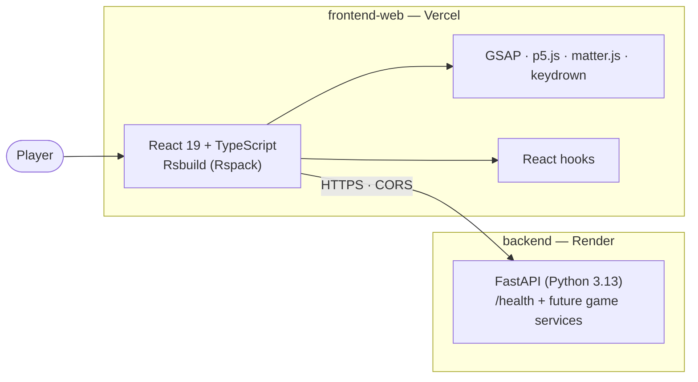

# Technical Architecture — NASA Explorer

## Overview



The game runs primarily in the browser. The FastAPI backend is a thin API that provides health checks today and a place for future game services (scores, shared data, server-side logic).

## Frontend

| Concern | Choice |
|---|---|
| Framework | React 19 + TypeScript |
| Build tool | Rsbuild (Rspack-based) |
| Animation / interactivity | React hooks, GSAP, p5.js, matter.js, keydrown |
| Lint & format | Biome |
| Typecheck | TypeScript (`tsc --noEmit`) |
| Package manager | pnpm 12 (Node 22) |

Role of the libraries:

- **matter.js** — 2D physics engine driving movement, gravity, collisions, and environmental interaction.
- **p5.js** — creative coding for procedural visuals and effects.
- **GSAP** — timeline and tween animations for transitions and UI motion.
- **keydrown** — keyboard input handling for movement and controls.
- **React hooks** — state and lifecycle for the game shell and UI overlays.

## Backend

| Concern | Choice |
|---|---|
| Framework | FastAPI |
| Runtime | Python 3.13 |
| Server | uvicorn |
| Package manager | uv |
| Lint & format | Ruff |
| Typecheck | ty |

Current surface:

- `GET /health` → `{"status": "ok"}` (used by Render health checks).
- CORS configured via the `CORS_ORIGINS` environment variable (comma-separated, defaults to `*`).

## Tooling and quality

| Tool | Purpose |
|---|---|
| `just` | Task runner (`just setup`, `just run`, `just check`, `just lint`) |
| Biome | Frontend lint + format |
| Ruff | Backend lint + format |
| ty | Backend type checking |
| GitHub Actions | CI: frontend lint/typecheck, backend lint/format/typecheck, security checks |
| gitleaks | Secret scanning in CI |

## AI assistants and MCP

Development uses three AI coding assistants, each with mirrored project rules:

- **OpenCode** — `.opencode/`
- **Kilocode** — `.kilo/`
- **Claude Code** — `.claude/` (via `CLAUDE.md` → `@AGENTS.md`)

MCP integrations are used for document and design tooling (LibreOffice, Obsidian, Penpot). Full disclosure is in [`ai_usage_disclosure.md`](ai_usage_disclosure.md).

## Repository layout

```text
.
├── frontend-web/          # React + TypeScript + Rsbuild game client
│   ├── src/               # App entry and components
│   ├── public/            # Static assets
│   ├── Dockerfile         # nginx static build (Docker path)
│   └── vercel.json        # Vercel build + SPA rewrite
├── backend/               # FastAPI app (uv)
│   ├── app/               # Application code
│   ├── Dockerfile         # uv multi-stage image (Docker path)
│   └── pyproject.toml     # Dependencies + tool config
├── docs/                  # Design and submission documentation
├── docker-compose.yml     # Production-style local stack
├── justfile               # Dev task runner
└── .github/workflows/     # CI
```

## Deployment topology

| Component | Host | URL | Notes |
|---|---|---|---|
| Frontend | **Vercel** | https://nasa-explorer-8s6l.vercel.app | Static build (`pnpm build` → `dist`), SPA fallback rewrite, preview per PR |
| Backend | **Render** | https://nasa-explorer-cpd9.onrender.com (health: `/health`) | Python native runtime, `uv sync --frozen --no-dev`, health check `/health` |
| Local (optional) | **Docker Compose** | — | Frontend on `:3000` (nginx), backend on `:8000` |

The frontend is a static site, so it is served from Vercel's CDN. The backend must set `CORS_ORIGINS` to the frontend origin(s) for cross-origin requests.

## Non-functional notes

- **Responsive by default** — UI and layout target desktop and mobile.
- **Physics consistency** — behaviour emerges from `matter.js` rather than scripted animation.
- **Performance** — static hosting plus a thin backend keeps the runtime footprint small.
