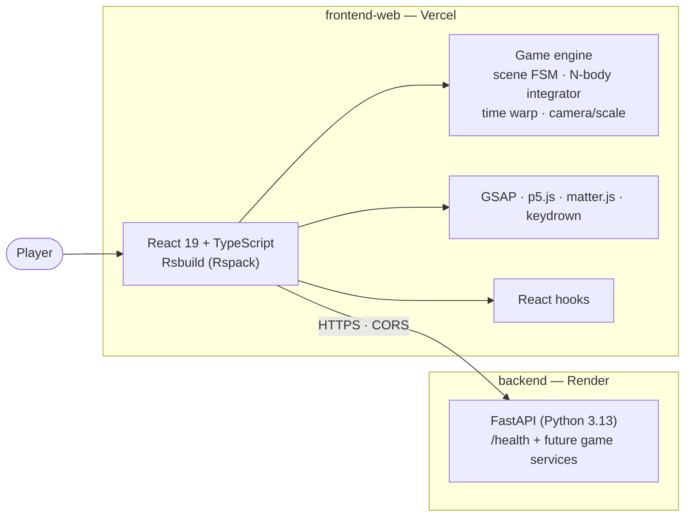
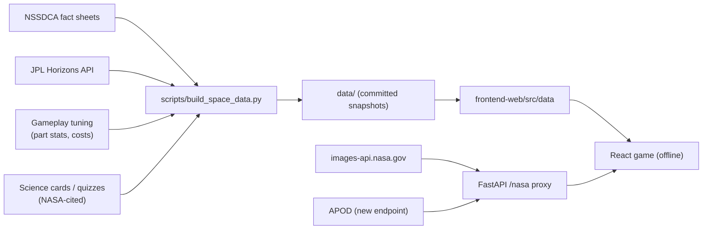

# Technical Architecture — NASA Explorer

## Overview



The game runs primarily in the browser. The FastAPI backend is a thin API that provides health checks today and a place for future game services (scores, shared data, server-side logic).

## Frontend

| Concern | Choice |
|---|---|
| Framework | React 19 + TypeScript |
| Build tool | Rsbuild (Rspack-based) |
| Animation / interactivity | React hooks, GSAP, p5.js, matter.js, keydrown |
| Lint & format | Biome |
| Typecheck | TypeScript (`tsc --noEmit`) |
| Package manager | pnpm 12 (Node 22) |

Role of the libraries:

- **matter.js** — 2D collisions and surface contact (walking, rovers, EVA contact). The orbital/gravity simulation uses the custom engine integrator, not matter.js gravity.
- **p5.js** — the render loop and procedural visuals (starfields, gradients, silhouettes, HUD-adjacent effects).
- **GSAP** — timeline and tween animations for menu transitions and UI motion.
- **keydrown** — keyboard input handling for movement and controls.
- **React hooks** — state and lifecycle for the game shell and UI overlays.

## Game engine

The game runs in a **single persistent canvas** that is mounted for the whole session. The menu is an overlay on top of the live world, so starting the game retires the overlay instead of loading a new scene.

```text
src/
  scenes/          # menu, rocket_assembly, flight, space_travel,
                   # planet_surface, planet_orbit
  engine/          # game_loop, scene_manager, camera, time_warp,
                   # gravity_bodies, integrator, atmosphere, input
  rendering/       # starfield, earth, rocket, astronaut, hud
  state/           # game_state, rocket_config, economy,
                   # journey_progress, save_load
  education/       # mission_control, science_cards, quizzes
  interface/       # menu, assembly, hud, quiz, two_view_switcher
```

- **Scene FSM** — `menu → assembly → launch → ascent → orbit → cruise → approach → landed`, plus `planet_surface` ↔ `planet_orbit` views. The world is never unmounted.
- **Integrator** — symplectic velocity Verlet with adaptive step and a per-frame step budget. See [`flight_model.md`](flight_model.md).
- **Time warp** — multiplier over simulated steps (×1 → ×100,000), with a "simulating…" indicator when the step budget is exceeded.
- **Web Worker** — optional off-thread integration at high warp, posting position snapshots to the render thread.
- **Camera/scale** — local, orbital, cruise, system-map, and whole-planet views over the same physical coordinates.
- **Save/load** — local guest profile in `localStorage` (no account system in this build).

The FastAPI backend remains a thin API; multiplayer and login are menu stubs in this build.

## Backend

| Concern | Choice |
|---|---|
| Framework | FastAPI |
| Runtime | Python 3.13 |
| Server | uvicorn |
| Package manager | uv |
| Lint & format | Ruff |
| Typecheck | ty |

Current surface:

- `GET /health` → `{"status": "ok"}` (used by Render health checks).
- CORS configured via the `CORS_ORIGINS` environment variable (comma-separated, defaults to `*`).

## Tooling and quality

| Tool | Purpose |
|---|---|
| `just` | Task runner (`just setup`, `just run`, `just check`, `just lint`) |
| Biome | Frontend lint + format |
| Ruff | Backend lint + format |
| ty | Backend type checking |
| GitHub Actions | CI: frontend lint/typecheck, backend lint/format/typecheck, security checks; `Deploy Frontend`: production deploy to Vercel after CI passes |
| gitleaks | Secret scanning in CI |

## AI assistants and MCP

Development uses three AI coding assistants, each with mirrored project rules:

- **OpenCode** — `.opencode/`
- **Kilocode** — `.kilo/`
- **Claude Code** — `.claude/` (via `CLAUDE.md` → `@AGENTS.md`)

MCP integrations are used for document and design tooling (LibreOffice, Obsidian, Penpot). Full disclosure is in [`ai_usage_disclosure.md`](ai_usage_disclosure.md).

## Repository layout

```text
.
├── frontend-web/          # React + TypeScript + Rsbuild game client
│   ├── src/               # App entry, scenes, engine, rendering, state,
│   │                      # education, interface, and mirrored data
│   ├── public/            # Static assets
│   ├── Dockerfile         # nginx static build (Docker path)
│   └── vercel.json        # Vercel build + SPA rewrite
├── backend/               # FastAPI app (uv)
│   ├── app/               # Application code
│   │   ├── routers/       # /nasa live data proxy (facts, media)
│   │   └── data/fallback/ # Bundled fallbacks for the proxy
│   ├── Dockerfile         # uv multi-stage image (Docker path)
│   └── pyproject.toml     # Dependencies + tool config
├── data/                  # Committed NASA snapshots (sources + provenance)
├── scripts/               # Data build + validation (Python, stdlib)
├── docs/                  # Design and submission documentation
├── docker-compose.yml     # Production-style local stack
├── justfile               # Dev task runner
└── .github/workflows/     # CI
```

## Data flow



Stable values (body constants, travel references, gameplay tuning, cited educational content) are snapshotted at build time and bundled with the frontend, so the game is playable with no network. Volatile content (daily APOD, image search) goes through the keyless proxy with TTL caching and bundled fallbacks. Gameplay tuning values are explicitly **not** NASA specifications and are labelled as such in the data files.

## Deployment topology

| Component | Host | URL | Notes |
|---|---|---|---|
| Frontend | **Vercel** | https://nasa-explorer-8s6l.vercel.app | Static build (`pnpm build` → `dist`), SPA fallback rewrite; production deployed by the `Deploy Frontend` GitHub Actions workflow after CI passes |
| Backend | **Render** | https://nasa-explorer-cpd9.onrender.com (health: `/health`) | Python native runtime, `uv sync --frozen --no-dev`, health check `/health` |
| Local (optional) | **Docker Compose** | — | Frontend on `:3000` (nginx), backend on `:8000` |

The frontend is a static site, so it is served from Vercel's CDN. The backend must set `CORS_ORIGINS` to the frontend origin(s) for cross-origin requests.

## Non-functional notes

- **Responsive by default** — UI and layout target desktop and mobile; touch controls mirror keyboard.
- **Physics consistency** — all motion emerges from the numerical integrator rather than scripted animation; matter.js handles collisions and surface contact.
- **Time warp** — step-budgeted so high warp never blocks the render loop; heavy integration can move to a Web Worker.
- **Offline-first** — committed NASA snapshots and educational content bundle with the frontend.
- **Performance** — a single persistent canvas, static hosting, and a thin backend keep the runtime footprint small.
